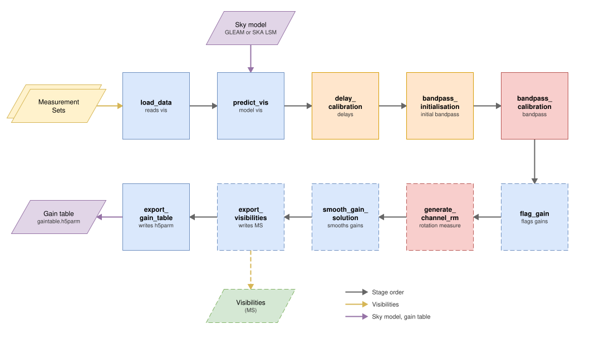
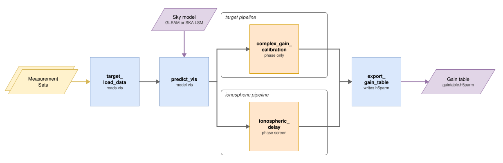

Pipeline Flow
=============

This page describes what each stage of the INST pipelines does, how data flows through them, which visibilities each solver stage uses, and how the computation is run.

INST provides three pipelines:

.. list-table::
   :header-rows: 1
   :widths: 30 45 25

   * - Pipeline
     - Command
     - Exported solutions
   * - Calibrator (bandpass)
     - ``ska-sdp-instrumental-calibration``
     - Bandpass gains
   * - Target complex gain
     - ``ska-sdp-instrumental-target-calibration``
     - Phase-only complex gains
   * - Target ionospheric
     - ``ska-sdp-instrumental-target-ionospheric``
     - Ionospheric phase screen gains

The parameters of every stage are described in :doc:`stage_config`.

.. _diagram-legend:

.. raw:: html

   

   
Reading the diagrams: shapes and colours

.. list-table::
   :header-rows: 1
   :widths: 30 70

   * - Shape
     - Meaning
   * - |square_orange| Orange square
     - Solver stage that solves on the beam centre normalised data, when produced (see :ref:`fallback <normalised-data-fallback>`).
   * - |square_red| Red square
     - Solver stage that solves on the un-normalised data.
   * - |square_blue| Blue square
     - Stage that does not solve for gains (loading, prediction, flagging, smoothing, export).
   * - |para_yellow| Yellow parallelogram
     - Input visibilities.
   * - |para_purple| Purple parallelogram
     - Sky model or gain table.
   * - |para_green| Green parallelogram
     - Output visibilities.
   * - |para_stacked| Stacked parallelograms
     - A set of files, for example several Measurement Sets.
   * - |dashed| Dashed border
     - Stage that is off by default, or its output.

|arrow_grey| Grey arrows show the order of the stages. The diagrams are editable draw.io SVG files, under `docs/src/diagrams <https://gitlab.com/ska-telescope/sdp/science-pipeline-workflows/ska-sdp-instrumental-calibration/-/tree/main/docs/src/diagrams>`_. Open them in draw.io (diagrams.net) to change them.

.. raw:: html

   

Calibrator pipeline
-------------------

The calibrator pipeline, ``ska-sdp-instrumental-calibration``, solves for the bandpass of a calibrator observation. It is based on the `script <https://gitlab.com/ska-telescope/ssc/ska-ssc-low-comm-tools/-/blob/main/src/low_comm_tools/sdp/inst_mitch.py?ref_type=heads>`_ used by the CommSci team to validate the AA0.5 data. Its initial solves follow RCAL. Its stages run in the order below. Stages that are off by default can be turned on in the ``pipeline`` section of the config. The ``experimental`` subcommand allows the calibration stages to be reordered and repeated, see :doc:`experimental_pipeline`.

.. list-table::
   :header-rows: 1
   :widths: 25 12 63

   * - Stage
     - Default
     - What it does
   * - ``load_data``
     - on
     - Reads each Measurement Set (through its zarr cache) into ``vis``, and creates an empty bandpass gain table.
   * - ``predict_vis``
     - on
     - Predicts ``modelvis`` from the sky model, with the station beam by default, and, if enabled, the beam centre normalised vis and model vis.
   * - ``delay_calibration``
     - on
     - Solves for the station delays, and applies them to the visibilities. Solves on the **normalised** vis and model vis (see :ref:`fallback <normalised-data-fallback>`).
   * - ``bandpass_initialisation``
     - on
     - Makes the initial bandpass solve, unless ``delay_calibration`` already did. Solves on the **normalised** vis and model vis (see :ref:`fallback <normalised-data-fallback>`).
   * - ``bandpass_calibration``
     - on
     - Solves for the bandpass. Solves on the **un-normalised** ``vis`` (or ``corrected_vis``, see ``visibility_key``) and ``modelvis``.
   * - ``flag_gain``
     - off
     - Flags outliers in the gain table. Uses no visibilities.
   * - ``generate_channel_rm``
     - off
     - Fits a rotation measure per station, re-predicts ``modelvis`` with it, and solves again. Solves on the **un-normalised** ``vis`` (or ``corrected_vis``) and the re-predicted ``modelvis``.
   * - ``smooth_gain_solution``
     - off
     - Smooths the gain table along frequency. Uses no visibilities.
   * - ``export_visibilities``
     - off
     - Writes ``vis`` (or ``corrected_vis``) and ``modelvis`` as Measurement Sets.
   * - ``export_gain_table``
     - on
     - Writes the gain table of each field as an h5parm.

Only the initial solves, ``delay_calibration`` and ``bandpass_initialisation``, use the beam centre normalised data. The later solves use the un-normalised data, so the exported bandpass is the physical gain, including the beam centre response.

With ``export_gaintable`` (on by default), each solver stage also writes its intermediate gain table as an h5parm under the QA directory of the run. With ``plot_config``, it also plots it.

load_data
^^^^^^^^^

``load_data`` reads the Measurement Sets (MSv2) passed as positional arguments. Each Measurement Set is first converted to a zarr dataset, chunked along frequency (``nchannels_per_chunk``) and time (``ntimes_per_ms_chunk``), which the later stages read. The zarr dataset is stored in ``cache_directory`` (by default ``.cache`` under the output directory), and is reused by later runs on the same data.

With ``nchannels_per_chunk: auto`` (the default), the number of channels per chunk is estimated from the size of the visibilities and the threads and memory of the dask cluster. The frequency chunks are what lets the later stages process the channels in parallel.

The data is read from ``datacolumn`` and ``weightcolumn``, for the given ``field_id`` and ``data_desc_id``. The stage also creates an empty bandpass gain table, with one solution per channel, which the solver stages fill in.

.. _calibrator-predict-vis:

predict_vis
^^^^^^^^^^^

``predict_vis`` builds a local sky model of the components within ``fov`` degrees of the phase centre and brighter than ``flux_limit`` Jy. The components are read from the GLEAM catalogue (``gleamfile``) or from a sky model CSV in the SKA LSM format (``lsm_csv_path``). When ``--sdm-path`` is passed, the sky model of the field is read from the Science Data Model instead, see :doc:`sdm_mode`.

The stage then predicts the model visibilities ``modelvis`` for each solution interval. With ``use_everybeam`` (the default), the station beam from EveryBeam is included. When the Measurement Set lacks the metadata EveryBeam needs, another Measurement Set can be given with ``eb_ms``.

The stage also produces the beam centre normalised visibilities, as set by ``normalise_at_beam_centre``, see :ref:`beam-centre-normalisation`. With ``export_sky_model``, the sky model is written as a CSV under the QA directory.

delay_calibration
^^^^^^^^^^^^^^^^^

``delay_calibration`` solves for a delay per station and polarisation, on the **normalised** data. By default (``extract_delays_from_vis: false``) it runs a full gain solve, and fits the delays to the phases of the solved gains (``oversample`` sets the resolution of the fit). With ``extract_delays_from_vis: true``, it uses a K-type solver, which extracts the delays from the visibilities directly.

The stage then applies the delays to ``vis``, and to ``beam_normalised_vis`` when it is produced, so the later stages work on delay corrected visibilities.

bandpass_initialisation
^^^^^^^^^^^^^^^^^^^^^^^

``bandpass_initialisation`` makes the initial bandpass solve, on the **normalised** data, which the main solve starts from. When ``delay_calibration`` already ran a full gain solve (the default), the bandpass is already initialised: this stage then skips its own solve, and only exports the gain table.

bandpass_calibration
^^^^^^^^^^^^^^^^^^^^

``bandpass_calibration`` is the main bandpass solve, on the **un-normalised** ``vis`` (or ``corrected_vis``, see ``visibility_key``) and ``modelvis``, so the solutions include the beam centre response.

The solve is set with ``run_solver_config``: the ``solver`` algorithm (``gain_substitution``, ``jones_substitution``, ``normal_equations``, ``normal_equations_presum``, or ``dp3_gaincal``, which needs the ``dp3`` extra), the reference antenna, the number of iterations and the tolerance, and whether to solve for phases only or for the cross polarisations. With ``visibility_filters``, only the visibilities within a ``uvdist`` range, or without the ``exclude_baselines``, are used.

flag_gain
^^^^^^^^^

``flag_gain`` is off by default. It flags outliers in the gain table, without using the visibilities. For each station, it removes the trend of the gains (``soltype``: ``amplitude``, ``phase``, ``amp-phase`` or ``real-imag``) across frequency with a fit of order ``order``, and flags the values further than ``n_sigma`` times the median absolute deviation. With ``n_sigma_rolling``, it also flags the regions whose running RMS (over ``window_size`` channels) is too high. The flagging repeats up to ``max_ncycles`` times. With ``apply_flag``, the flags are written to the weights of the gain table.

generate_channel_rm
^^^^^^^^^^^^^^^^^^^

``generate_channel_rm`` is off by default. It fits a rotation measure per station to the current gain table, re-predicts ``modelvis`` with these rotation measures, and solves for the gains again, on the **un-normalised** ``vis`` (or ``corrected_vis``) and the re-predicted ``modelvis``. When ``beam_normalised_modelvis`` is produced, it is updated from the new ``modelvis``, so a later initial solve stays consistent.

smooth_gain_solution
^^^^^^^^^^^^^^^^^^^^

``smooth_gain_solution`` is off by default. It smooths the gains along frequency, with a running ``mean`` or ``median`` (``mode``) over ``window_size`` channels. It uses no visibilities.

export_visibilities
^^^^^^^^^^^^^^^^^^^

``export_visibilities`` is off by default. It writes ``vis``, ``modelvis``, or both (``data_to_export``) as Measurement Sets, under a ``visibilities`` subdirectory of the output directory. With ``apply_gaintable_to_vis`` (the default), the gain table solved so far is applied to ``vis`` first, which produces ``corrected_vis``.

.. _calibrator-export-gain-table:

export_gain_table
^^^^^^^^^^^^^^^^^

``export_gain_table`` writes the final gain table as an h5parm, one per field. When ``--sdm-path`` is passed, it is written to the Science Data Model, under ``calibration/bandpass/<field_id>/``, otherwise to the output directory, see :doc:`sdm_mode`. With ``export_metadata``, a metadata file describing the data product is written too.

Target pipelines
----------------

The target pipelines solve for the gains of a target observation, after the bandpass of the calibrator has been applied to it. The target complex gain pipeline (``ska-sdp-instrumental-target-calibration``) and the target ionospheric pipeline (``ska-sdp-instrumental-target-ionospheric``) differ only in their solver stage. The colours follow the :ref:`legend <diagram-legend>`.

.. list-table::
   :header-rows: 1
   :widths: 25 12 63

   * - Stage
     - Default
     - What it does
   * - ``target_load_data``
     - on
     - Reads all the Measurement Sets into one ``vis``, and creates an empty gain table with ``timeslice`` solution intervals.
   * - ``predict_vis``
     - on
     - Same stage as in the calibrator pipeline.
   * - ``complex_gain_calibration`` (target pipeline only)
     - on
     - Solves for phase-only complex gains. Solves on the **normalised** vis and model vis (see :ref:`fallback <normalised-data-fallback>`).
   * - ``ionospheric_delay`` (ionospheric pipeline only)
     - on
     - Solves for the direction independent ionospheric delay, as a phase screen. Solves on the **normalised** vis and model vis (see :ref:`fallback <normalised-data-fallback>`).
   * - ``export_gain_table``
     - on
     - Writes the gain table as an h5parm.

Both target solves use the beam centre normalised data when ``predict_vis`` produces it.

target_load_data
^^^^^^^^^^^^^^^^

``target_load_data`` reads the target Measurement Sets, like ``load_data``, but combines all of them into a single dataset (and a single zarr cache). The gain table it creates has one solution per ``timeslice`` seconds, instead of one per channel.

predict_vis (target)
^^^^^^^^^^^^^^^^^^^^

The same stage as :ref:`in the calibrator pipeline <calibrator-predict-vis>`.

complex_gain_calibration
^^^^^^^^^^^^^^^^^^^^^^^^

``complex_gain_calibration`` runs only in the target complex gain pipeline. It solves for phase-only complex gains, with the ``gain_substitution`` solver, on the **normalised** data. The reference antenna, iterations and tolerance are set with ``run_solver_config``. ``export_gain_table`` writes the solutions to the Science Data Model under ``calibration/gains/<field_id>/``, when ``--sdm-path`` is passed.

ionospheric_delay
^^^^^^^^^^^^^^^^^

``ionospheric_delay`` runs only in the target ionospheric pipeline. It is a direction independent ionospheric delay calibration: the other ionospheric effects are direction dependent, and are not solved here. It models the ionosphere as a phase screen over the stations, made of Zernike polynomials (up to ``zernike_limit``), and solves for it from the difference between the observed and model visibilities, on the **normalised** data. The stations can be grouped in clusters with ``cluster_indexes``, which are solved together (``block_diagonal``) or one after the other. The solutions are not applied to the visibilities. ``export_gain_table`` writes them to the Science Data Model under ``calibration/ionosphere/<field_id>/``, when ``--sdm-path`` is passed.

The ionospheric calibration method is explained in the `ska-sdp-func-python documentation <https://developer.skao.int/projects/ska-sdp-func-python/en/latest/ionospheric_calibration.html>`_.

export_gain_table (target)
^^^^^^^^^^^^^^^^^^^^^^^^^^

The same stage as :ref:`in the calibrator pipeline <calibrator-export-gain-table>`.

Data used by the stages
-----------------------

Visibilities passed between stages
^^^^^^^^^^^^^^^^^^^^^^^^^^^^^^^^^^

Each stage receives the output of the previous stage and passes on an updated version of it. The visibility datasets in it are:

``vis``
   The observed visibilities read by ``load_data`` (or ``target_load_data``).
``modelvis``
   The model visibilities predicted by ``predict_vis`` from the local sky model, including the station beam when ``use_everybeam`` is true.
``beam_normalised_vis`` and ``beam_normalised_modelvis``
   ``vis`` and ``modelvis`` multiplied by the inverse of the beam response in the beam pointing direction (the beam centre). They are only produced when ``predict_vis`` normalises at the beam centre, see below.
``corrected_vis``
   ``vis`` with the current gain table applied. Only produced by ``export_visibilities`` when ``apply_gaintable_to_vis`` is true.

.. _beam-centre-normalisation:

Normalisation at the beam centre
^^^^^^^^^^^^^^^^^^^^^^^^^^^^^^^^

The station beam scales the visibilities by the beam response. Solving on visibilities and model visibilities normalised at the beam centre removes most of this scaling from the solutions, which helps the initial solves to converge. This follows the initial diagonal solve of RCAL.

``predict_vis`` controls this with ``normalise_at_beam_centre``:

.. list-table::
   :header-rows: 1
   :widths: 20 40 40

   * - Value
     - ``beam_normalised_vis``
     - ``beam_normalised_modelvis``
   * - ``true`` (default)
     - Produced
     - Produced
   * - ``"vis"``
     - Produced
     - Not produced
   * - ``"modelvis"``
     - Not produced
     - Produced
   * - ``false``
     - Not produced
     - Not produced

Normalisation needs the EveryBeam model, so nothing is normalised when ``use_everybeam`` is false, whatever the value of ``normalise_at_beam_centre``.

.. _normalised-data-fallback:

.. important::

   A stage that "solves on the normalised data" picks each side on its own, and silently falls back to the un-normalised data when the normalised version is not produced:

   - vis: ``beam_normalised_vis`` if produced, otherwise ``vis``.
   - model vis: ``beam_normalised_modelvis`` if produced, otherwise ``modelvis``.

   So what these stages actually solve on depends on ``normalise_at_beam_centre`` and ``use_everybeam``:

   - ``true`` (with EveryBeam): normalised vis against normalised model vis.
   - ``"vis"`` or ``"modelvis"``: only one side is normalised, so the solutions absorb the beam centre response.
   - ``false``, or ``use_everybeam: false``: un-normalised vis against un-normalised model vis, the same as every other stage.

Several Measurement Sets
^^^^^^^^^^^^^^^^^^^^^^^^

The calibrator pipeline processes each Measurement Set separately: ``load_data`` loads each of them on its own, and every later stage runs once per Measurement Set, with its own gain table. ``export_gain_table`` then groups the gain tables by field, joins the gain tables of a field along time, and writes one file per field. The intermediate gain tables and plots are written per Measurement Set.

The target pipelines load all the Measurement Sets as one dataset, see `target_load_data`_.

Lazy execution
--------------

The stages do not process the data when they run. The visibilities and gain tables are xarray datasets backed by dask arrays, so each stage only adds its operations to the dask task graph, and passes the lazy result on to the next stage.

Work with a side effect is not done by the stages either: writing the final and intermediate gain tables, writing the visibilities, and plotting. A stage wraps such work in a deferred task, and registers it with the task manager of the pipeline (``scheduler/task_manager.py``).

Once all the stages have run, the runner (``InstrumentalDaskRunner``) asks the task manager to compute the registered tasks, in two steps:

1. **Persist.** The inputs of all the tasks are persisted together, with ``dask.persist`` and graph optimisation. The parts of the graph that several tasks share, such as the visibilities and the solved gain tables, are computed only once, and kept in memory.
2. **Compute.** All the tasks are then computed together, with a single ``dask.compute`` call, using the persisted inputs.

Where this computation runs is described in :doc:`running_pipeline`.

The only work done earlier is the conversion of a Measurement Set to its zarr cache in ``load_data`` (or ``target_load_data``), when the cache does not exist yet. It is written before the rest of the graph is built, as the later stages read the visibilities from the cache.

Configurations
--------------

Generate the config with the ``install-config`` subcommand. It writes the default config of the installed version of the pipeline, with every parameter at its default value:

.. code-block:: bash

   ska-sdp-instrumental-calibration install-config --config-install-path ./config

The target pipelines have their own ``install-config`` subcommand, which writes their own default config.

Change only the parameters you need, with ``--set``. It works with both ``install-config`` and ``run``, for example:

.. code-block:: bash

   ska-sdp-instrumental-calibration install-config --config-install-path ./config \
       --set parameters.load_data.nchannels_per_chunk 32

   ska-sdp-instrumental-calibration run --config ./config/ska_sdp_instrumental_calibration.yaml \
       --set parameters.load_data.nchannels_per_chunk 32 \
       /path/to/data.ms

The parameters are described in :doc:`stage_config`.

The `configs <https://gitlab.com/ska-telescope/sdp/science-pipeline-workflows/ska-sdp-instrumental-calibration/-/tree/main/configs>`_ directory of the repository holds example configs, with example values filled in. They are only meant as a reference: start from the config written by ``install-config``, so that it matches the version of the pipeline you run.

.. list-table::
   :header-rows: 1
   :widths: 35 65

   * - Config
     - Pipeline
   * - `calibrator_inst_run.yml <https://gitlab.com/ska-telescope/sdp/science-pipeline-workflows/ska-sdp-instrumental-calibration/-/blob/main/configs/calibrator_inst_run.yml>`_
     - Calibrator pipeline, ``run`` subcommand.
   * - `calibrator_inst_experimental.yml <https://gitlab.com/ska-telescope/sdp/science-pipeline-workflows/ska-sdp-instrumental-calibration/-/blob/main/configs/calibrator_inst_experimental.yml>`_
     - Calibrator pipeline, ``experimental`` subcommand, with the stages reordered and repeated.
   * - `target_inst.yaml <https://gitlab.com/ska-telescope/sdp/science-pipeline-workflows/ska-sdp-instrumental-calibration/-/blob/main/configs/target_inst.yaml>`_
     - Target complex gain pipeline.
   * - `target_ionospheric.yaml <https://gitlab.com/ska-telescope/sdp/science-pipeline-workflows/ska-sdp-instrumental-calibration/-/blob/main/configs/target_ionospheric.yaml>`_
     - Target ionospheric pipeline.
